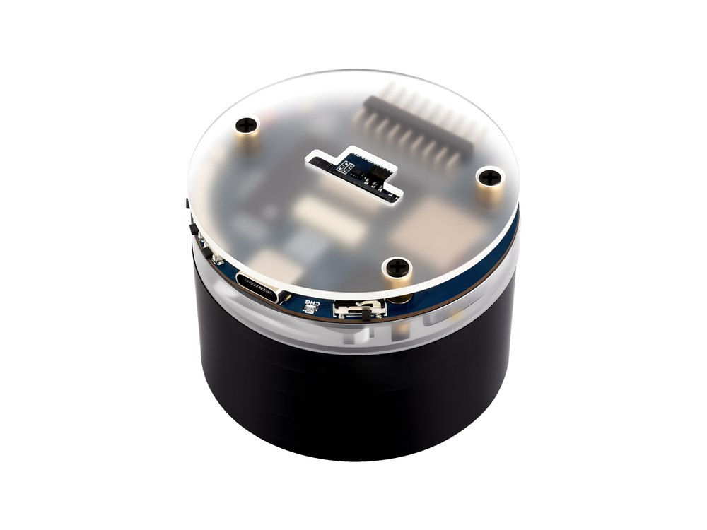

  <h1>ESP32-S3-AUDIO-Board</h1>
  
<strong>ESP32-S3 audio development board with a dual-microphone array and RGB light ring</strong>

  
<strong>English</strong> | <a href="README_ZH.md">简体中文</a>

  

    
    
    
  

  

    <a href="https://www.waveshare.com/esp32-s3-audio-board.htm">🛒 Product</a> &middot;
    <a href="firmware/">📦 Firmware</a> &middot;
    <a href="examples/esp-idf/">🧩 ESP-IDF</a> &middot;
    <a href="examples/arduino/examples/">🔧 Arduino</a> &middot;
    <a href="https://docs.waveshare.com/ESP32-S3-AUDIO-Board">📖 Documentation</a>
  

  

---

## ✨ Overview

The ESP32-S3-AUDIO-Board is a development board for voice recognition and audio playback. This package includes ESP-IDF and Arduino examples, firmware images and the board schematic.

| Feature | Device or interface |
| --- | --- |
| MCU | ESP32-S3R8 |
| Memory | 16 MB Flash, 8 MB octal PSRAM |
| Audio | ES8311 codec, ES7210 ADC, dual microphones and a speaker connector |
| Peripherals | RGB light ring, TF card slot, LCD and camera connectors |

## 📦 Quick Start

1. Download the original factory image from [firmware](firmware/).
2. Connect the board with a USB data cable.
3. Flash the combined BIN at offset `0x0` using the [flashing guide](https://docs.waveshare.com/ESP32-S3-AUDIO-Board/Firmware-Flashing).
4. Reset the board if it does not restart automatically.

The factory image restores the out-of-box audio and lighting demo.

## 🧪 Examples

### ESP-IDF

| Example | Main feature |
| --- | --- |
| [ESP-SR](examples/esp-idf/esp_sr_02/) | Voice wake-up and recognition on the serial monitor |
| [MP3 playback](examples/esp-idf/mp3_play_03/) | Play MP3 files from a TF card |
| [LVGL 9.3](examples/esp-idf/lvgl9_3_example_04/) | Touch UI, MP3 playback and speech recognition |

### Arduino

| Example | Main feature |
| --- | --- |
| [LVGL Arduino](examples/arduino/examples/LVGL_Arduino/) | Touch UI and TF card audio playback |

The separate [factory demo project](examples/factory/) includes button controls, MP3 playback and RGB effects.

## 🛠️ Development Environment

| Framework | Configured version | Examples |
| --- | --- | ---: |
| ESP-IDF | `v5.5.5` | 3 |
| Arduino-ESP32 | `3.2.1` | 1 |

The factory demo project uses ESP-IDF `v5.5.4`.

## 📚 Resources

- [Schematic](hardware/schematic/)
- [Product page](https://www.waveshare.com/esp32-s3-audio-board.htm)
- [Wiki](https://docs.waveshare.com/ESP32-S3-AUDIO-Board)

## 🤝 Support

- [Waveshare product support](https://docs.waveshare.com/ESP32-S3-AUDIO-Board/Technical-Support)

## 📄 License

Apache License 2.0. See [LICENSE](LICENSE).
