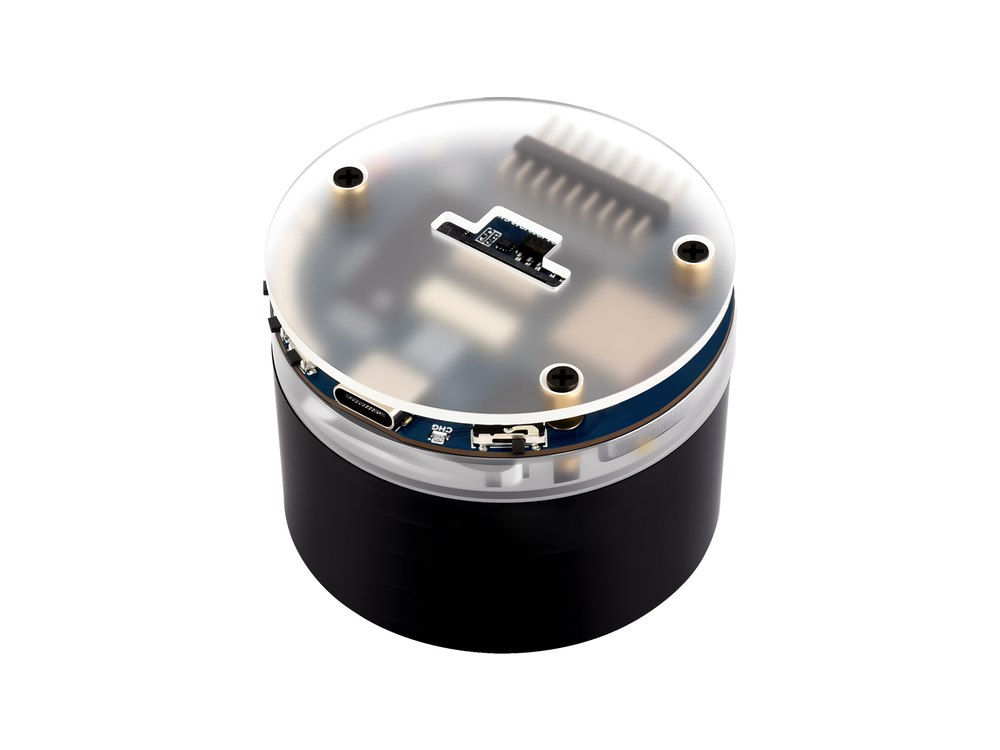

  <h1>ESP32-S3-AUDIO-Board</h1>
  
<strong>带双麦克风阵列和彩色灯环的 ESP32-S3 音频开发板</strong>

  
<a href="README.md">English</a> | <strong>简体中文</strong>

  

    
    
    
  

  

    <a href="https://www.waveshare.com/esp32-s3-audio-board.htm">🛒 产品</a> &middot;
    <a href="firmware/README_ZH.md">📦 固件</a> &middot;
    <a href="examples/esp-idf/">🧩 ESP-IDF</a> &middot;
    <a href="examples/arduino/examples/">🔧 Arduino</a> &middot;
    <a href="https://docs.waveshare.net/ESP32-S3-AUDIO-Board/">📖 文档</a>
  

  

---

## ✨ 概述

ESP32-S3-AUDIO-Board 是一款面向语音识别和音频播放的开发板。示例包包含 ESP-IDF 和 Arduino 示例、固件镜像及开发板原理图。

| 功能 | 器件或接口 |
| --- | --- |
| MCU | ESP32-S3R8 |
| 存储器 | 16 MB Flash，8 MB 八线 PSRAM |
| 音频 | ES8311 编解码器、ES7210 ADC、双麦克风和扬声器接口 |
| 外设 | RGB 灯环、TF 卡槽、LCD 和摄像头接口 |

## 📦 快速开始

1. 从[固件目录](firmware/README_ZH.md)下载原出厂镜像。
2. 用 USB 数据线连接开发板。
3. 按[烧录指南](https://docs.waveshare.net/ESP32-S3-AUDIO-Board/Firmware-Flashing/)将合并 BIN 烧录到 `0x0`。
4. 如果开发板未自动重启，请手动复位。

出厂镜像用于恢复开箱音频与灯光演示。

## 🧪 示例

### ESP-IDF

| 示例 | 主要功能 |
| --- | --- |
| [ESP-SR](examples/esp-idf/esp_sr_02/README_ZH.md) | 语音唤醒与识别，通过串口显示结果 |
| [MP3 播放](examples/esp-idf/mp3_play_03/README_ZH.md) | 播放 TF 卡中的 MP3 文件 |
| [LVGL 9.3](examples/esp-idf/lvgl9_3_example_04/README_ZH.md) | 触控界面、MP3 播放和语音识别 |

### Arduino

| 示例 | 主要功能 |
| --- | --- |
| [LVGL Arduino](examples/arduino/examples/LVGL_Arduino/README_ZH.md) | 触控界面与 TF 卡音频播放 |

[出厂演示工程](examples/factory/README_ZH.md)提供按键控制、MP3 播放和 RGB 灯效。

## 🛠️ 开发环境

| 开发框架 | 配置版本 | 示例数 |
| --- | --- | ---: |
| ESP-IDF | `v5.5.5` | 3 |
| Arduino-ESP32 | `3.2.1` | 1 |

出厂演示工程使用 ESP-IDF `v5.5.4`。

## 📚 资料

- [原理图](hardware/schematic/)
- [产品页](https://www.waveshare.com/esp32-s3-audio-board.htm)
- [Wiki](https://docs.waveshare.net/ESP32-S3-AUDIO-Board/)

## 🤝 支持

- [微雪技术支持](https://docs.waveshare.net/ESP32-S3-AUDIO-Board/Technical-Support/)

## 📄 许可证

Apache License 2.0，详见 [LICENSE](LICENSE)。
